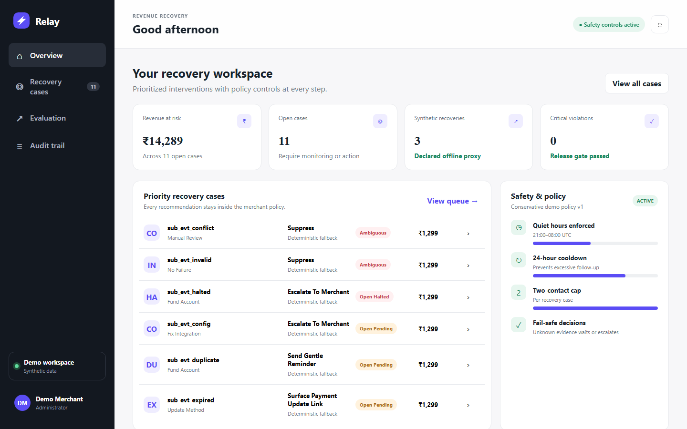
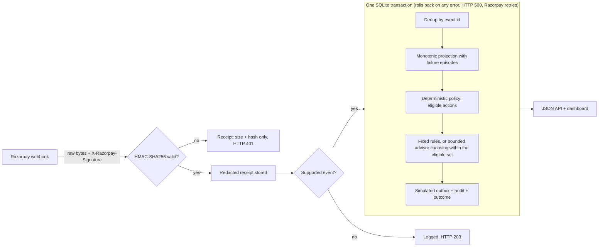

# Relay — failed subscription payment recovery for Razorpay

[](https://github.com/Sai181006/Recovery_of_revenue/actions/workflows/ci.yml)

> **Live demo:** not deployed yet — config is ready in `render.yaml`, steps in [docs/DEPLOY.md](docs/DEPLOY.md).
> The demo shows **synthetic fixture data only** and is **read-only**. Merchant roles use an `X-Merchant-Role` header, which is **not real authentication**.

When a recurring Razorpay payment fails, Relay decides the next step — wait, remind the customer, ask them to update their payment method, or escalate to the merchant — and records why.
It verifies each webhook's HMAC signature, ignores duplicate and out-of-order events, and processes every event in a single SQLite transaction.
Every action comes from fixed, auditable rules (quiet hours, cooldowns, contact caps, consent); unknown or contradictory input fails closed.
An optional advisor may only choose among actions the rules already allow. A Claude adapter exists for offline evaluation, but live webhook decisions use the fixed rules and no live evaluation has been run yet.
Messaging, payment links and authentication are simulated, and all demo data is synthetic. It is a portfolio project, not a production service.


_Dashboard in seeded demo mode. Every case, amount and "synthetic recovery" shown is hand-written fixture data._

## Quickstart

Requires Node.js 24+.

```sh
git clone https://github.com/Sai181006/Recovery_of_revenue.git && cd Recovery_of_revenue
npm install
npm run dev
```

Open http://localhost:3000. `npm run dev` resets and seeds the 14 synthetic scenarios on every start.

With Docker instead (no Node needed):

```sh
docker build -t revenue-recovery .

# Seeded demo (synthetic data, reset on every start). Add -e READ_ONLY=true to mirror the public demo.
docker run --rm -p 3000:3000 -v recovery-demo:/data revenue-recovery tools/demo-server.ts demo

# Production mode: starts empty and never seeds synthetic data; SQLite persists in the volume.
# /cases, /webhook-receipts and controls need -e ADMIN_TOKEN=... (sent as "Authorization: Bearer ...").
docker run --rm -p 3000:3000 -v recovery-data:/data revenue-recovery
```

CI builds this image and smoke-tests both commands on every push.

## How it works



- **Episodes:** a failure after a recovery (next billing cycle) opens a new episode with a fresh contact cap. A normal monthly `subscription.charged` with nothing open is ignored, so routine revenue is never counted as "recovered".
- **Stale events** (older than the current state) are audited but cannot trigger new actions.
- **Consent** gates customer contact only; merchant escalation (e.g. a halted subscription) does not need it.
- More detail: [docs/ARCHITECTURE.md](docs/ARCHITECTURE.md), [docs/SCHEMAS.md](docs/SCHEMAS.md).

## What is tested

| Command                   | What it checks                                                                                                                                                                                    |
| ------------------------- | ------------------------------------------------------------------------------------------------------------------------------------------------------------------------------------------------- |
| `npm run verify`          | Prettier, ESLint + a safety lint, strict TypeScript, all tests, 14 scenarios, evaluation release gate (also runs in CI)                                                                           |
| `npm test`                | Unit, HTTP-route, webhook, atomicity and projection tests. Prints the current count; all use synthetic fixtures except replay of real captures                                                    |
| `npm run scenarios`       | 14 hand-written end-to-end scenarios (insufficient funds, expired card, halted, duplicate, out-of-order, quiet hours, opt-out, ...)                                                               |
| `npm run evaluate`        | Compares no-contact, fixed-rule and simulated-advisor strategies on the same 14 synthetic scenarios; writes `reports/evaluation-v1.json`                                                          |
| `npm run evaluate:live`   | Runs the Claude advisor on the same 14 synthetic scenarios next to the fixed rules; prints decision sources and rejected outputs. Needs an Anthropic API key and costs API usage; **not run yet** |
| `npm run captured:report` | Lists real Razorpay **test-mode** captures and replays them. Captured so far: **none** — see [docs/RAZORPAY_TEST_MODE.md](docs/RAZORPAY_TEST_MODE.md)                                             |

"Synthetic recoveries" in the evaluation are a declared fixture label, not observed revenue, lift or causal evidence.

## Limitations

- No real customers, no production deployment, no real money processed.
- Messaging and payment links are simulated; nothing is sent.
- No authentication: roles come from a header. Protection is limited to `READ_ONLY` and one shared `ADMIN_TOKEN`.
- Live webhook decisions come from fixed rules. The Claude advisor adapter is tested only against a mocked provider; `npm run evaluate:live` (needs your API key, billed) has not been run.
- Real Razorpay test-mode capture tooling exists, but no events have been captured yet.
- Single process, local SQLite, no scheduler (a "wait" decision is never revisited).

Full list: [docs/LIMITATIONS.md](docs/LIMITATIONS.md).

## Reference

### Modes and configuration

`APP_MODE` is `demo`, `development` or `production` (default). Only demo/development seed synthetic data. Copy `.env.example` to `.env` to change settings; invalid configuration fails before listening, and error messages name fields without printing values.

| Variable                                                 | Default                | Purpose                                                                          |
| -------------------------------------------------------- | ---------------------- | -------------------------------------------------------------------------------- |
| `HOST`, `PORT`                                           | `127.0.0.1`, `3000`    | Listen address (the Docker image uses `0.0.0.0`)                                 |
| `DATA_PATH`                                              | `data/recovery.sqlite` | SQLite file                                                                      |
| `READ_ONLY`                                              | `false`                | Refuse every merchant control                                                    |
| `ADMIN_TOKEN`                                            | unset                  | Shared Bearer token; required in production for data routes and controls         |
| `WEBHOOK_ENABLED`, `RAZORPAY_WEBHOOK_SECRET`             | `false`, unset         | Enable `POST /webhooks/razorpay`; the secret is required when enabled            |
| `WEBHOOK_ASSUME_CONSENT`, `WEBHOOK_ASSUME_CONTACT_ROUTE` | `false`                | Test mode only: let customer-contact decisions appear (delivery stays simulated) |

### Commands

`npm start` (production mode), `npm run dev` (seeded development), `npm run demo` (full release check, then seeded demo), `npm run demo:reset` / `demo:seed`, `npm run capture:webhooks`, `npm run release:check` (verify + secret and artifact audit).

### HTTP routes

`GET /health`, `GET /cases`, `GET /cases/{id}`, `GET /evaluation`, `GET /webhook-receipts`, `POST /webhooks/razorpay`, `POST /cases/{id}/suppress`, `POST /cases/{id}/override`, `POST /outbox/{id}/deliver`. Errors are `{ error, code, message }` with stable codes; internal details are never returned.

### Code layout

- `src/webhook.ts` signature verification, redaction, Razorpay event mapping
- `src/pipeline.ts` dedup, projection, decision, outbox, outcome (one transaction)
- `src/policy.ts` eligibility rules; `src/advisor.ts` bounded advisor contract and validation
- `src/adapters/claude-advisor.ts` Claude API adapter (bounded input, JSON parse only; validation stays in `advisor.ts`)
- `src/store.ts` SQLite repository; `src/http-app.ts` routes and access checks
- `src/config.ts`, `src/runtime.ts`, `src/server.ts` configuration, startup, graceful shutdown
- `fixtures/synthetic/` hand-written data; `fixtures/captured/` real test-mode captures (empty so far)

Never commit `.env`, keys, webhook secrets, real contact details or live payment data.
